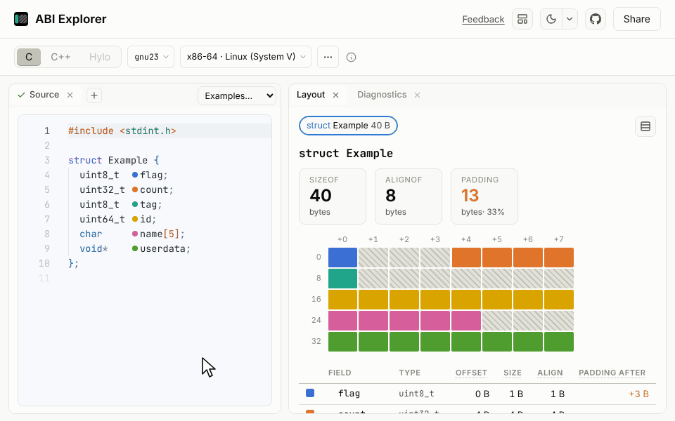

# ABI Explorer

See how a compiler lays out your C, C++ or Hylo types in memory: where each
field lands, where the padding goes, and what `sizeof` and `alignof` come to on
the platform you care about.

**[Open abiexplorer.org](https://abiexplorer.org)**. It runs in your browser,
nothing is uploaded, and it keeps working offline.

The struct above is 40 bytes on x86-64, 13 of them padding. On AVR it is 21
bytes with none.

## What you can do with it

- Hover a line of code to light up its bytes, or hover a byte to see which
  field owns it.
- Switch platforms. More than 40 targets are built in, from x86-64 and AArch64
  to Windows on Arm, RISC-V, WebAssembly and 8-bit AVR. Any triple clang
  accepts can be typed in.
- `#include <string>` works for every target, so `sizeof(std::string)` is the
  answer for the platform you picked rather than the machine you are sitting
  at.
- See the hard cases: bit-fields drawn bit by bit, vtable pointers, virtual
  bases, the empty base optimization, `[[no_unique_address]]` and reused tail
  padding. The Examples menu has one of each.
- Try the flags that change layout, such as `-fpack-struct`, `-mms-bitfields`
  and `-fshort-enums`.
- Share a link to exactly what you are looking at. In
  [Compiler Explorer](https://godbolt.org), "Open in ABI Explorer" brings your
  code across.

## In your editor

The same engine runs in VS Code with your project's own compile flags. Hover a
struct to see its layout. If its member order wastes space, you get a warning
and a quick fix that reorders the members.

Install it from the
[VS Code Marketplace](https://marketplace.visualstudio.com/items?itemName=hylo-lang.abi-explorer)
or, for VSCodium, Cursor and other VS Code forks,
[Open VSX](https://open-vsx.org/extension/hylo-lang/abi-explorer)
([more about the extension](editors/vscode/README.md)).

CLion, Zed and Neovim builds are archives on the
[releases page](https://github.com/tothambrus11/abi-explorer-2/releases);
[installing one by hand](editors/RELEASING.md#installing-a-build-by-hand) takes
a few steps.

## How it works

The answers come from the compilers themselves, compiled to WebAssembly.

For C and C++ that is
[clang-abi-wasm](https://github.com/tothambrus11/clang-abi-wasm): clang's
parser, type checker and knowledge of every target's ABI, without the LLVM
backends that would generate code. Clang works out the full structure while
it lays a record out, including which bytes belong to which base class, and
the engine hands that structure over as data. Reconstructing it from a list of
offsets means guessing, and the guess goes wrong exactly in the interesting
cases, like a derived class reusing a base's tail padding.

An earlier version compiled your code six or more times per keystroke and
pieced the layout together from text dumps. Asking clang directly took a plain
struct from 33 ms to under 2 ms, and one that includes `<string>` from 948 ms
to 440 ms. What remains there is clang parsing libc++.

For Hylo it is [hylo-abi-wasm](https://github.com/tothambrus11/hylo-abi-wasm),
built from the [Hylo](https://hylo-lang.org) compiler. Hylo's layouts are worth
a look because the rules differ: it stores members in order of decreasing
alignment, so a struct that is full of holes in C usually has none, and a Hylo
`enum` stores its cases on top of each other with a tag after them. The module
type-checks Hylo's standard library once when it loads, so the first answer
takes about a second and later ones about 15 ms.

Each compiler is downloaded only when you pick its language.

## Contributing

[CONTRIBUTING.md](CONTRIBUTING.md) covers setup, tests and deployment;
[editors/README.md](editors/README.md) covers the editor plugins. Tools that
want to link here can build links with the
[share-link package](packages/share-link/README.md) in this repo.

ABI Explorer was inspired by [Compiler Explorer](https://godbolt.org). Thanks
for all the work!
