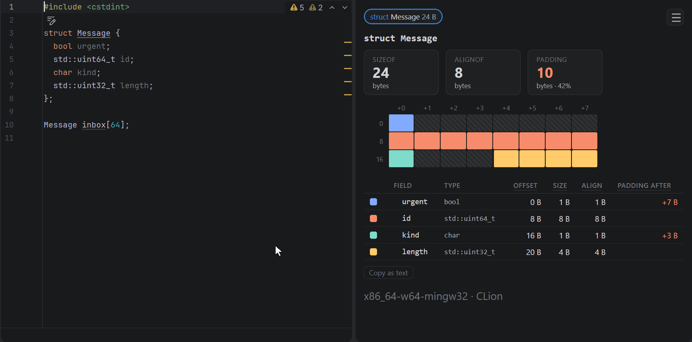

# ABI Explorer for CLion

CLion 2025.3.1 or newer (classic or Nova engine). Install `abi-explorer-clion-<version>.zip` from an
[editors release](https://github.com/tothambrus11/abi-explorer-2/releases) with Settings › Plugins › ⚙ ›
Install Plugin from Disk…; it is not on the JetBrains Marketplace yet.

Struct layouts from the project's own compiler and flags:

- **Quick documentation** (hover, or `F1`/`Ctrl+Q`) on a struct or member name, or any use of a
  struct (`std::string` too): its size, alignment, padding, byte map and member table.
- **Settings | Tools | ABI Explorer**: a target to lay structs out for
  instead of the project's own (`armv7-unknown-linux-gnueabihf`, say).
- A **warning** on a struct whose member order wastes space, saying how small another order
  would make it; its fix, **Reorder members by alignment** (`Alt+Enter`), moves the member
  lines into that order. A struct laid out on purpose keeps its order with
  `// abi-explorer: keep order` above it, which **Keep this member order** writes.
  **Pin layout with static_assert** is offered on any struct.
- **Struct Layout** tool window, drawn as the web explorer draws a layout (tabs, size tiles, a
  byte grid with bit-fields bit by bit, the nested member table) and following the caret: click a
  member to jump to it, a compound member's name to open its struct, or copy the layout as text.

Each file's compiler and switches come from CLion's project model, so no
`compile_commands.json` is needed and every build system CLion opens works the same way:

| Build system | In CLion | Tested |
|:--|:--|:--|
| CMake (presets, toolchains, any generator) | built in | yes |
| Conan | through CMake (`conan install` toolchain, or cmake-conan) | yes |
| Meson | built in | yes |
| Bazel | the Bazel plugin | yes |
| Makefile, compilation database, autotools | built in | as compilation databases |

"Tested" means `server/test/build-systems` builds a project with that build system, runs it, and
checks the layouts against the `sizeof` the program prints, using the commands as this plugin
pushes them. A header borrows the command of the source file most like it, as in clangd.

The language server runs on the machine's Node.js 20 or newer, or on Node.js downloaded once
when there is none.

Build with `npm run build` in `editors/` (the plugin bundles `server/dist` and `panel/dist`), then
`./gradlew buildPlugin` here; the plugin is in `build/distributions/`. `./gradlew -p core test`
tests the IDE-free logic, and `./gradlew test` runs `PluginSmokeTest` in the real IntelliJ
Platform: the plugin loads with its extensions, and the server it carries answers for a file whose
command is pushed as CLion pushes it. `./gradlew runIde` starts CLion with the plugin.
