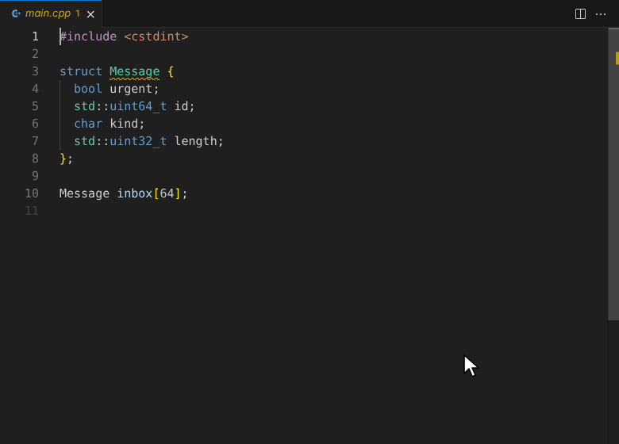

# ABI Explorer for VS Code

See how your C and C++ structs are laid out in memory, using your project's
own compile flags: each member's offset, the padding between them, and the
struct's size and alignment.

## Features

- **Hover a struct** for its size, alignment, padding and a map of its bytes.
  Hover a member for its offset. Any use of a type works too, library types
  like `std::string` included.
- **Find wasted space.** A struct whose member order leaves holes gets a
  warning that says how small it could be. The quick fix (`Ctrl+.`, or `Cmd+.`
  on macOS) reorders the members to pack them tightly. Positional initializers
  such as `{true, 42}` elsewhere then need the new order too. If the order is
  deliberate, say for a wire format, choose **Keep this member order**, which
  adds `// abi-explorer: keep order` above the struct.
- **Pin a layout.** The light bulb on any struct also offers _Pin layout with
  static_assert_, which adds assertions for its size and alignment (and member
  offsets, if the file includes `<cstddef>` or `<stddef.h>`), so a change that
  moves them breaks the build.
- **Struct Layout view.** A panel in the Explorer side bar (or run **ABI
  Explorer: Show Struct Layout**) shows the byte grid and member table of the
  struct under your cursor. Click a member to jump to it; hover a byte to
  highlight its member in the code.
- **Other targets.** Run **ABI Explorer: Choose Target…** to see the layout on
  another platform, such as 32-bit Arm or Windows, without a cross toolchain.

## Getting started

Open a C or C++ file and hover a struct. The extension picks up your compile
flags from, in order:

1. CMake Tools, if you use it
2. `compile_commands.json`, found the way clangd finds it, or wherever clangd
   or the C/C++ extension is told to look
3. `compile_flags.txt`
4. the `abiExplorer.fallbackFlags` setting

System headers come from asking your project's compiler (GCC, Clang or MSVC).
A compiler inside your workspace is run only if `abiExplorer.allowedCompilers`
lists it.

On first use the extension downloads the layout engine (about 50 MB) once.
It is clang compiled to WebAssembly, so it runs the same on every platform.

If a hover says _Nothing could be laid out_, the reason follows, usually a
missing include path. Fix it in your compile commands or
`abiExplorer.fallbackFlags`; if the hover doesn't pick that up, run **ABI
Explorer: Restart Server**.

## Settings

| Setting                          | What it does                                                                                                                     |
| :------------------------------- | :------------------------------------------------------------------------------------------------------------------------------- |
| `abiExplorer.target`             | Lay structs out for another target triple, such as `armv7-unknown-linux-gnueabihf`; your `-I`, `-D` and `-std` flags still apply |
| `abiExplorer.fallbackFlags`      | Flags for files no compile command covers, such as `["-std=c++20", "-Iinclude"]`                                                 |
| `abiExplorer.compileCommandsDir` | Where `compile_commands.json` is, if searching doesn't find it                                                                   |
| `abiExplorer.allowedCompilers`   | Globs of compilers inside your workspace that may be run to find system headers (none by default)                                |

## More

- [abiexplorer.org](https://abiexplorer.org): the same layouts in your browser,
  for more than 40 targets, and for the [Hylo](https://hylo-lang.org) language
- [Source and issues](https://github.com/tothambrus11/abi-explorer-2)
- Also available for CLion, Zed and Neovim, from the
  [releases page](https://github.com/tothambrus11/abi-explorer-2/releases)
